# Архитектура «Можно?»

Документ отвечает на критерий приёмки 2. Описано то, что реализовано в репозитории на 17.10.2026. Планируемые части помечены словом «план».

Диаграммы ниже в формате Mermaid (GitHub показывает их сразу). PNG-версии лежат в [docs/img/](img/), исходники в [docs/img/src/](img/src/).

> **Статус выкладки на 17.10.2026 22:15 МСК.** Онбординг-чат, напоминания, аналитика и дашборд (миграции 004-006, `app/api/v1/onboarding`, `app/api/v1/reminders`, `app/api/v1/analytics`, `app/internal`, `app/api/cron/reminders`) пока лежат в рабочей копии репозитория и не закоммичены. Production на них ещё не обновлён: `GET /api/v1/onboarding`, `/api/v1/reminders`, `/api/v1/analytics` и `/internal/analytics` на https://mozhno-mvp.vercel.app отвечают 404, при этом `/api/health` отвечает 200, а `/api/v1/me` — 401 (маршрут есть). Документы описывают код рабочей копии; чтобы метрики из этого документа появились в проде, нужно закоммитить, выкатить, применить миграции и задать `ANALYTICS_SECRET` и `ANALYTICS_ADMIN_SECRET`.

## 1. Контекст

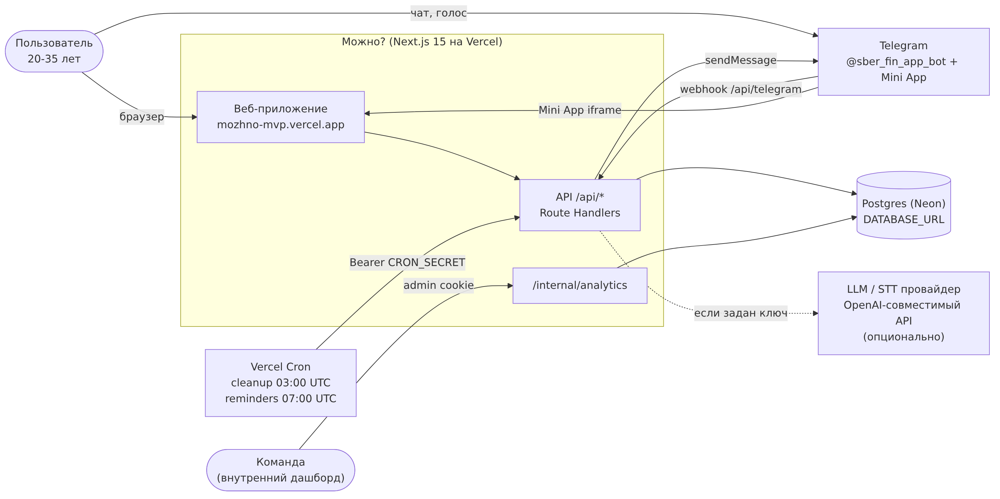

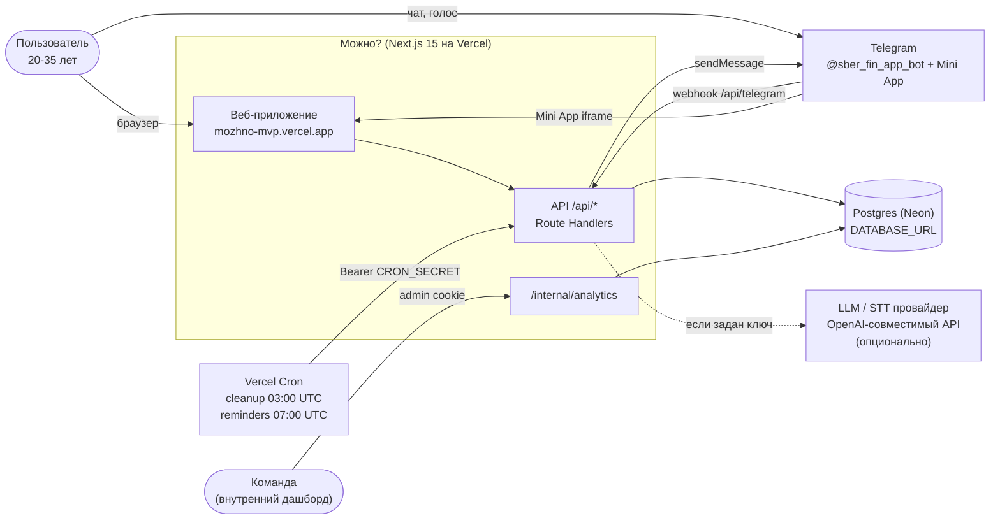

| Элемент | Что это | Где |
|---|---|---|
| Веб-приложение | Next.js 15 (App Router), React 19, TypeScript. Одна страница `app/page.tsx` с чатом знакомства, экраном «Сегодня», чатом «Можно?», голосом (Web Speech API или запись + `/api/stt`) | https://mozhno-mvp.vercel.app |
| Telegram-бот | grammY, `@sber_fin_app_bot`, webhook `/api/telegram`. Локально — polling (`npm run bot:poll`) | `lib/bot.ts` |
| Telegram Mini App | та же веб-страница внутри Telegram; вход по `initData` с проверкой HMAC (`POST /api/v1/session/telegram`) | `lib/telegram-webapp.ts` |
| API | Route Handlers в `app/api/**`, все динамические (`force-dynamic`), ответы `no-store` | Vercel Functions |
| БД | Postgres (Neon) через `pg`, пул `DATABASE_POOL_MAX=5`, TLS с проверкой сертификата. Локально и в тестах — PGlite (Postgres в WASM) | `lib/db.ts` |
| Cron | Vercel Cron: `/api/cron/cleanup` 03:00 UTC (retention + повтор Telegram-апдейтов), `/api/cron/reminders` 07:00 UTC (10:00 МСК) | `vercel.json` |
| LLM / STT | опционально, OpenAI-совместимый API (`LLM_BASE_URL`, `LLM_API_KEY`, `LLM_MODEL_PRIMARY`, `LLM_MODEL_FALLBACKS`, `STT_*`) через единый клиент с бюджетами и журналом `ai_usage`. Без ключа или при `LLM_ENABLED=0` — regex и шаблоны | `lib/llm/*` |
| Дашборд | `/internal/analytics`, доступ по `ANALYTICS_ADMIN_SECRET` | `app/internal/analytics` |

## 2. Компоненты

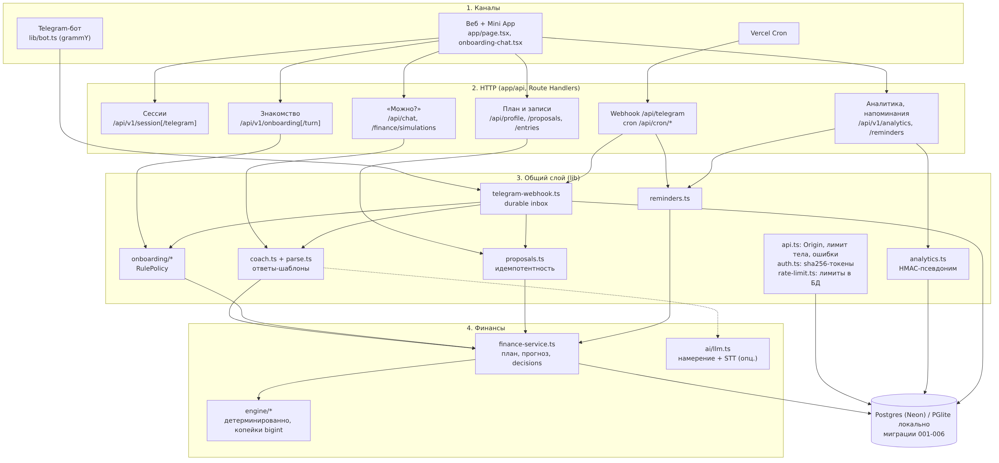

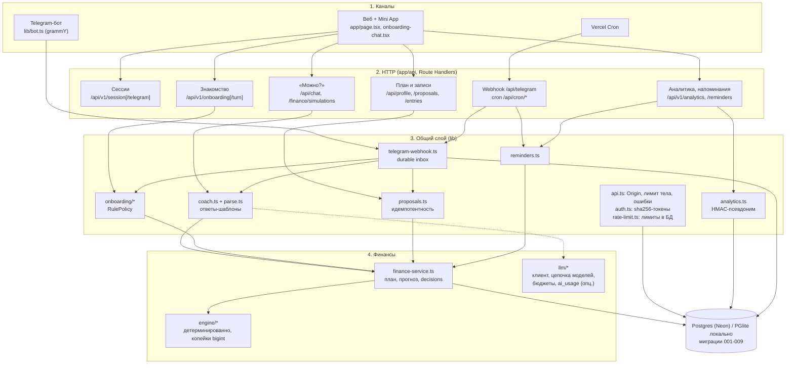

Слои:

1. **Каналы.** Веб и Mini App работают с одним API через cookie `mozhno_sid`. Бот вызывает те же доменные функции напрямую, без HTTP.
2. **HTTP.** Каждый изменяющий запрос проходит `assertSameOrigin` (CSRF по `Origin`/`Sec-Fetch-Site`), чтение тела потоком с лимитом в байтах, лимиты из `lib/rate-limit.ts` и единый формат ошибок `{ error: { code, message, requestId } }`.
3. **Общий слой.** `coach.ts` формирует ответы из чисел движка шаблонами; `onboarding/*` ведёт чат знакомства; `proposals.ts` подтверждает записи с идемпотентностью (`Idempotency-Key`, `SELECT … FOR UPDATE`, уникальный индекс); `telegram-webhook.ts` сохраняет апдейт в `inbox` до ответа и обрабатывает его после ответа (`after`) с арендой 120 с и до 3 попыток.
4. **Финансы.** `lib/engine/*` — чистые функции без ввода-вывода: деньги в копейках (`bigint`), строгие даты, прогноз по контрольным точкам, симуляция покупки (сейчас / после дохода / альтернативы), вердикт `fits_plan | reduces_daily_margin | touches_protected_money | cash_gap | insufficient_data`. `finance-service.ts` читает план из БД, вызывает движок и пишет `decisions`.

### Данные (миграции `db/migrations/001-009`)

| Миграция | Таблицы |
|---|---|
| 001_core | `users`, `identities` (telegram / anonymous / …), `sessions` (sha256 токена), `auth_challenges`, `books` (остаток, резерв, `finance_version`), `occurrences` (плановые доходы и платежи), `ledger_entries`, `goals`, `goal_allocations`, `proposals`, `decisions`, `finance_events`, `idempotency_keys`, `inbox`, `conversation_state` |
| 002_rate_limits | `rate_limits` + индексы под прогноз |
| 003_audit_fixes | контекст привязки Telegram, lease/attempts/last_error в `inbox`, `ledger_entries.occurred_on`, индексы retention |
| 004_onboarding_chat | `onboarding_session` (CAS по revision), `onboarding_message` (лента, идемпотентность по `client_key`) |
| 005_reminders | `reminder_settings`, `reminder_log` (дедуп по дню) |
| 006_analytics_events | `analytics_events`, `users.analytics_enabled`, `users.analytics_epoch` |
| 007_service_logs | `service_calls`, `service_errors`, `user_sources`, `users.is_internal` |
| 008_referrals | `referrals`, `referral_rewards`, `users.ref_code`, вид `user_referral_flags` |
| 009_ai_usage | `ai_usage` (журнал попыток вызова LLM: модель, токены, стоимость, итог), `budget_buckets` (атомарные счётчики бюджета LLM) |

Миграции применяются `npm run db:migrate` или автоматически при `MOZHNO_AUTO_MIGRATE=1` (advisory lock на время применения). PGlite мигрирует сам.

## 3. Поток вопроса «Можно?»

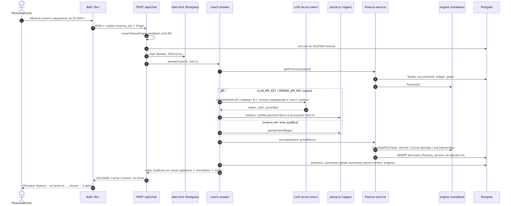

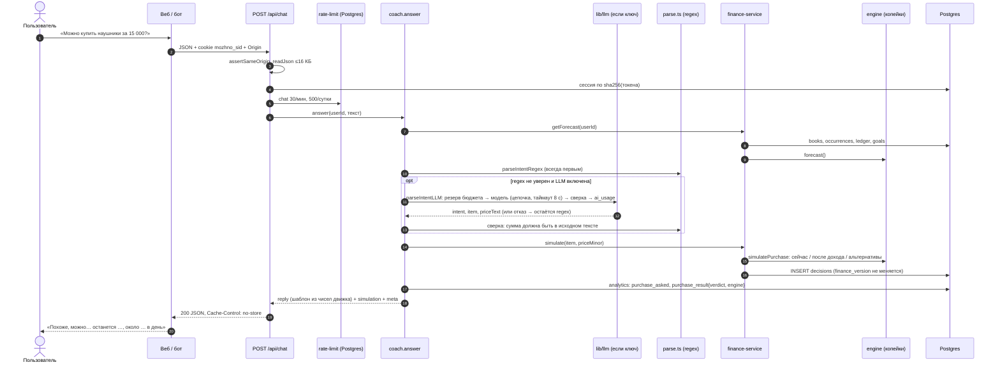

Ключевые правила:
- Числа в ответе считает только движок. LLM (если включена и regex не уверен) возвращает намерение и дословный текст суммы. Сумма принимается, только если такой денежный токен есть в исходном сообщении.
- Проверка покупки пишет `decisions` и не меняет `finance_version`. Запись траты создаёт `proposal`, который применяется только после подтверждения кнопкой.
- Структурированный вариант того же сценария: `POST /api/v1/finance/simulations` (цена в копейках, даты, альтернативы, подписка), `engine: "api"` в аналитике.

## 4. Онбординг-чат

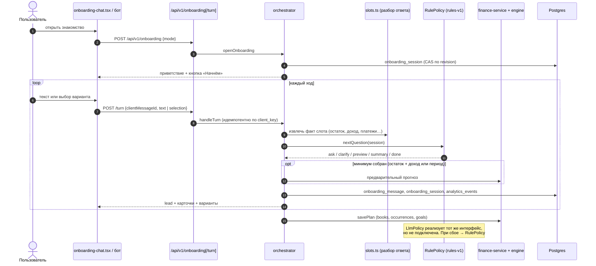

- Один сценарий для веба (`app/onboarding-chat.tsx`) и бота (`lib/onboarding/render-telegram.ts`), одна сессия на пользователя.
- Слоты: `balance`, `income`, `planningDays` (если дохода нет), `payments`, `reserve`, `essentialDaily`, `goal`. Обязательны остаток и доход или период. После минимума показывается предварительный прогноз.
- Следующий вопрос выбирает `RulePolicy` (`rules-v1`). `LlmPolicy` (`llm-v0-stub`) реализует тот же интерфейс `QuestionPolicy`, может выбирать только слот из схемы и при любой ошибке возвращает решение правил. Сейчас она не подключена.

## 5. Напоминания (cron)

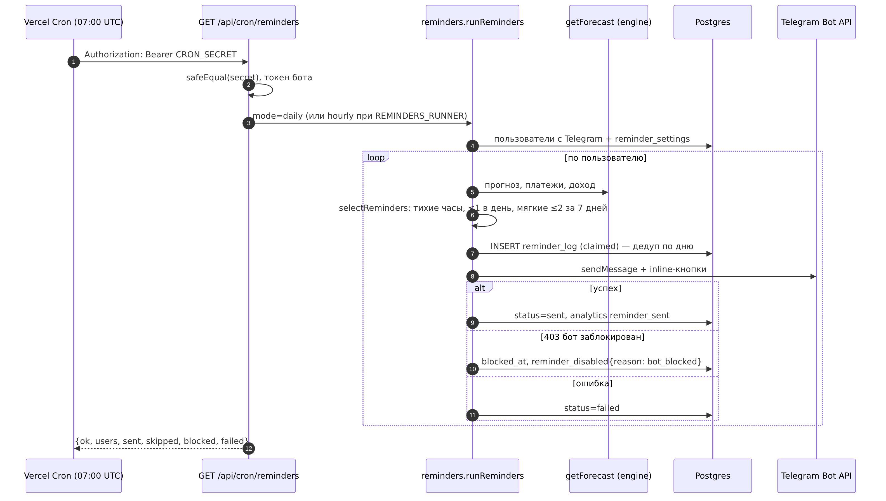

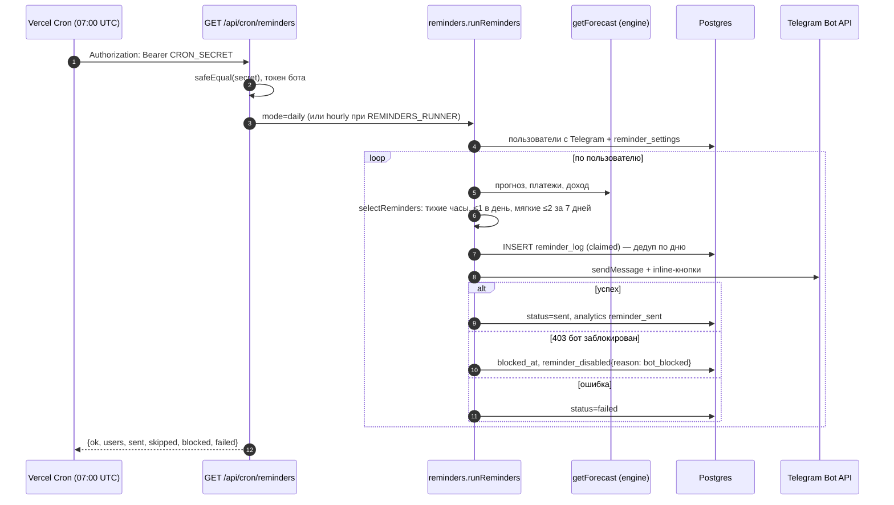

- Виды: `payment_due`, `payday`, `onboarding` включены по умолчанию; `log_nudge`, `weekly`, `morning` — по желанию. Не больше 1 сообщения в день и 2 «мягких» за 7 дней, тихие часы 22-9 по зоне пользователя.
- Vercel Hobby разрешает cron раз в день, поэтому режим `daily`. Внешний почасовой вызов того же URL с `REMINDERS_RUNNER=hourly` повторы не дублирует: дедуп по `reminder_log`.
- Тексты напоминаний шаблонные, числа берутся из `getForecast`.

## 6. Аналитика

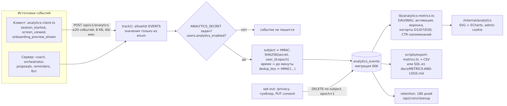

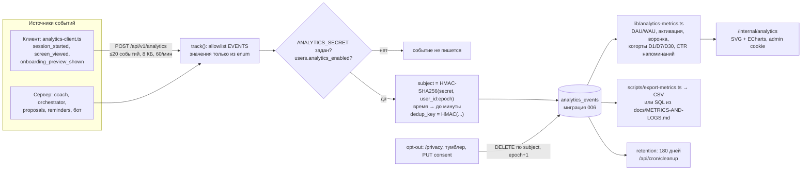

Подробности: [ANALYTICS.md](ANALYTICS.md), [METRICS-AND-LOGS.md](METRICS-AND-LOGS.md).

## 7. LLM-слой

Реализован в `lib/llm/` (v25). Схема-PNG ниже — исходный план; актуальная схема — mermaid под ней.

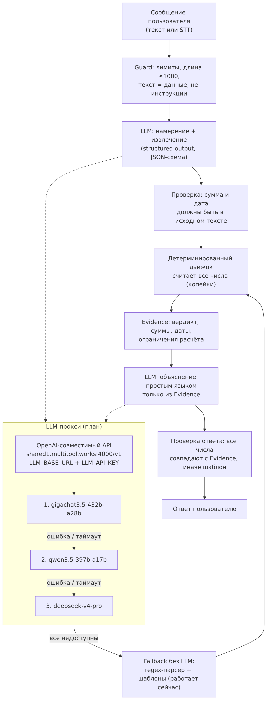

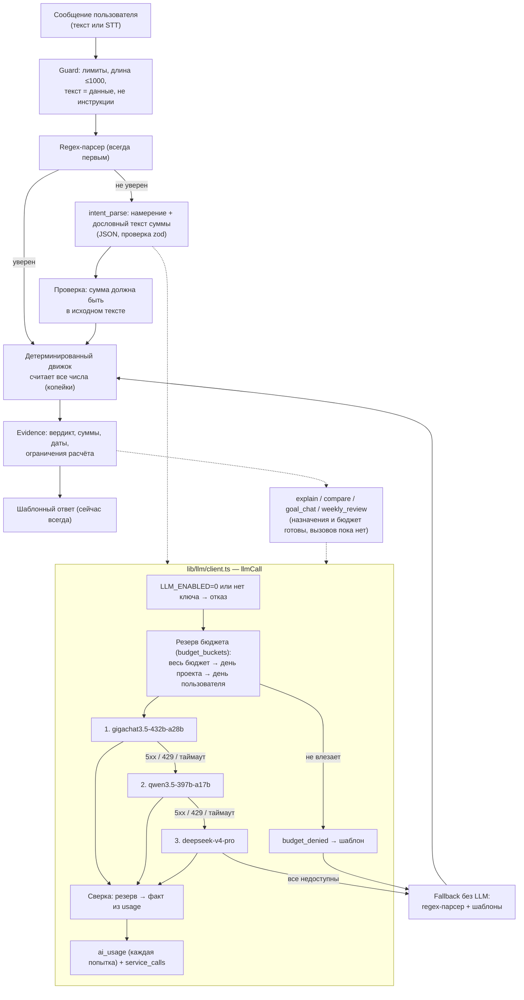

| Часть | Статус |
|---|---|
| Единый OpenAI-совместимый клиент `llmCall` (`fetch` к `/chat/completions`, `LLM_BASE_URL`, `LLM_API_KEY`) | есть, все вызовы модели идут через него |
| Цепочка `gigachat3.5-432b-a28b → qwen3.5-397b-a17b → deepseek-v4-pro` на стороне клиента: переход при 5xx, 429, сети и таймауте попытки (`LLM_TIMEOUT_MS`, общий дедлайн `LLM_TOTAL_TIMEOUT_MS`) | есть |
| Таблица цен (коп. за 1 млн токенов с НДС), переопределение `LLM_PRICES`, `LLM_PRICE_MARKUP` | есть, `lib/llm/prices.ts` |
| Атомарные бюджеты: потолок проекта в день (`LLM_DAILY_BUDGET_RUB`), мягкий лимит пользователя (`LLM_USER_DAILY_SOFT_CAP_RUB`), весь бюджет (`LLM_TOTAL_BUDGET_RUB`); дни по Москве; при ошибке БД — отказ | есть, `lib/llm/budget.ts`, таблица `budget_buckets` |
| Журнал `ai_usage` (каждая попытка) и `service_calls` (`llm.intent`, `llm.stt`, …); журналирование не бросает | есть |
| Выключатель `LLM_ENABLED=0` | есть |
| Типизированный результат (`ok` или отказ с причиной `disabled / not_configured / quota / budget / timeout / error / bad_output`); вызывающий код уходит в шаблон или regex | есть |
| Regex первым, LLM только при неуверенном разборе | есть (`regexUnsure`, `lib/coach.ts`) |
| Голос через тот же учёт (`voice_transcribe`, посекундно) | есть, `lib/llm/stt.ts` |
| Квоты AI-ответов: `setLlmHooks({ allow, onAnswer, onRelease })` → `lib/plans` (резерв по `request_id` до вызова, списание после ответа, возврат при сбое); разбор намерения, голос, ошибки и шаблоны не тратят. Бета-Плюс 15 в день, Free/Плюс по `PLANS_MODE=live`; при исчерпании — шаблон с числами движка | есть (миграция 010), `lib/plans/index.ts`, таблицы `ai_token_buckets`, `ai_token_ledger` |
| Проверка суммы от LLM по исходному тексту | есть |
| Ответы с числами только из шаблонов | есть |
| Интерфейс `QuestionPolicy` для LLM-выбора вопроса в онбординге | есть, не подключён (назначение `onboarding` в бюджете готово) |
| Evidence-модель для объяснений и проверка, что все числа в тексте совпадают с Evidence | есть: «Почему так? ✦» (`lib/explain.ts`, `POST /api/v1/explain`, кнопка в боте `ex:`) |
| Ключ прокси `accelerator-*` | не получен: включение — только env, см. README |

Учёт стоимости и SQL для «₽ на DAU»: [LLM-COST.md](LLM-COST.md#7-как-измеряется-фактический-расход). Дашборд — раздел 8 `/internal/analytics`.

## 8. Развёртывание и окружения

| Окружение | Как запускается | БД |
|---|---|---|
| Production | Vercel, проект `mozhno-mvp`, https://mozhno-mvp.vercel.app. Проверка 17.10.2026 21:33 МСК: `GET /api/health` → 200 `{"ok":true}`, `GET /` → 200 | Neon Postgres, `DATABASE_URL` |
| Локально | `npm run dev` (порт 3000) или `npm run build && npm start` | PGlite в `.data/pglite` или локальный Postgres |
| Тесты | `npm test` (vitest), каждый файл со своей PGlite в памяти, без сети и ключей | `memory://` |
| CI | GitHub Actions: `npm ci`, typecheck, lint, test, `npm audit --audit-level=high`, build (Node 22) | — |

Безопасность: заголовки CSP (`frame-ancestors` только Telegram), HSTS, `nosniff`; cookie `HttpOnly; Secure; SameSite=None` в production (нужно для iframe Telegram), CSRF закрыт проверкой `Origin`; секрет вебхука Telegram обязателен и сравнивается за постоянное время; `CRON_SECRET` для cron; в логах нет пользовательского ввода.

## 9. Масштабирование и известные узкие места

По результатам [нагрузочного теста](LOAD-TEST.md) (локальная production-сборка, один процесс Node.js, локальный Postgres):
- Один запрос делает много последовательных SQL-выражений (подсчёт по журналу Postgres): `POST /api/chat` — 25, `/api/v1/finance/simulations` — 18, `/api/v1/onboarding/turn` — 16, `/api/v1/onboarding` — 14, `/api/v1/analytics` — 10, `/api/v1/session` — 6, `/api/health` — 1. Сюда входят проверка и продление сессии, UPSERT лимитов в `rate_limits`, чтение плана, запись `decisions` и по 2 запроса на каждое событие аналитики (чтение согласия + INSERT).
- Один процесс Node.js упирается в одно ядро CPU около 300 RPS смешанного трафика. Увеличение пула БД с 5 до 20 улучшило p95 на 300 RPS с 388 до 164 мс, но предел почти не сдвинуло.
- На Vercel функции масштабируются горизонтально, поэтому раньше упрёмся в соединения и запросы к Neon. Что делать при росте: пулер Neon (pgbouncer) и `DATABASE_POOL_MAX`; счётчики лимитов в Redis/Upstash вместо Postgres; кеш согласия на аналитику на время запроса и пакетная запись событий; кеш прогноза по `(user_id, finance_version, today)`; объединение чтения плана в один запрос.
