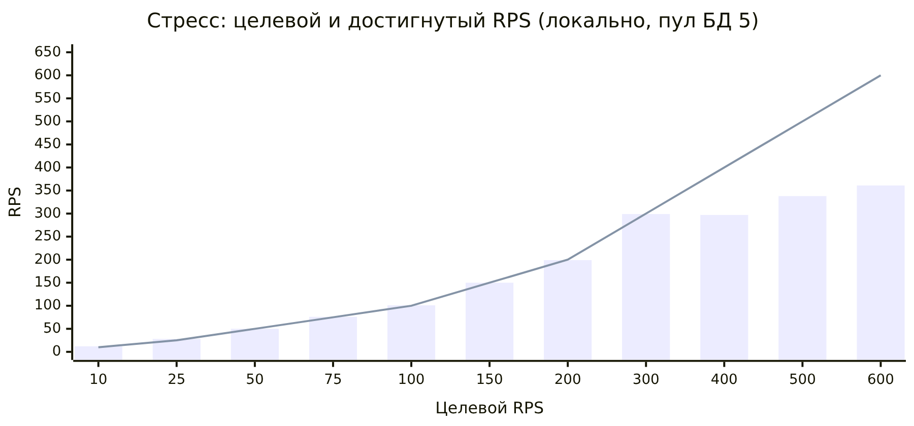
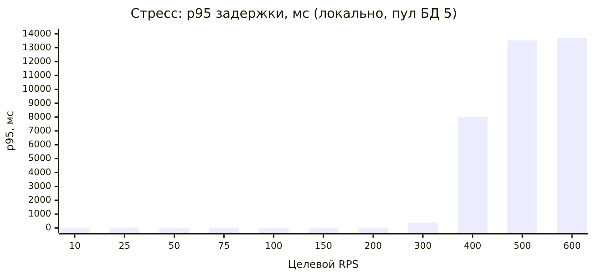

# Нагрузочное тестирование

Критерий приёмки 1: отчёт о нагрузочном тестировании до 10 RPS на сервис с TPM, TPS и стресс-тестами.

Тест проведён 17.10.2026 с 21:42 до 22:11 МСК против **локальной production-сборки** (`next build` + `next start`, `NODE_ENV=production`). Production (https://mozhno-mvp.vercel.app) под нагрузку не ставился. Цифры на Vercel + Neon будут другими (см. раздел 6).

## 1. Итог

| Проверка | Результат |
|---|---|
| Смешанный трафик 10 RPS, 3 минуты | 1 806 запросов, 10,0 RPS (600 TPM), p50 13 мс, p95 23 мс, p99 31 мс, ошибок 0% |
| Каждый сервис отдельно на 10 RPS, по 1 минуте | p95 от 3 мс (`GET /`) до 17 мс (`POST /api/chat`), ошибок 0% |
| Стресс 10 → 150 RPS ступенями | деградации нет: на 150 RPS p95 16 мс, ошибок 0% |
| Поиск предела 200 → 600 RPS | колено около **300 RPS**: p95 растёт с 25 мс (200 RPS) до 388 мс (300 RPS); выше пропускная способность упирается в 300-360 RPS, p95 8-14 с, k6 не успевает запускать итерации (`dropped_iterations`) |
| HTTP-ошибки во всех прогонах | 0 из ~231 000 запросов, включая setup (5xx и 4xx нет, лимиты не срабатывали) |
| Узкое место | один процесс Node.js (~1 ядро CPU), затем число SQL на запрос и пул соединений |

TPS здесь равен RPS: один HTTP-запрос — одна пользовательская операция. TPM = RPS × 60.

## 2. Окружение

| Параметр | Значение |
|---|---|
| Машина | общая Linux-машина (Debian 13), 8 vCPU Intel Xeon, 15 ГБ RAM. На ней параллельно работали другие процессы, фон 5-10% CPU |
| Приложение | Next.js 15.5.28, `next start`, один процесс Node.js 20.19.2, без кластера |
| БД | локальный PostgreSQL 17 на той же машине (`shared_buffers=256MB`, `max_connections=100`), миграции 001-006 через `MOZHNO_AUTO_MIGRATE=1`. PGlite не использовался: это одно соединение в WASM с сериализацией запросов, в production его нет |
| Пул БД | `DATABASE_POOL_MAX=5` (как по умолчанию в production); отдельный прогон с 20 |
| LLM, Telegram | выключены: ключей LLM нет, ответы через regex-парсер и шаблоны (`engine: fallback`); бот и cron не участвовали |
| Аналитика | включена (`ANALYTICS_SECRET` задан на время теста), события пишутся в `analytics_events` |
| Генератор нагрузки | k6 v1.3.0 на той же машине (конкурирует за CPU) |
| Сеть | localhost, без TLS и без задержек сети |

Авторизация — штатный механизм приложения: `POST /api/v1/session` выдаёт анонимную сессию (cookie `mozhno_sid`), `POST /api/profile` сохраняет план. Лимит создания сессий 30 в час на IP, поэтому каждый виртуальный клиент получает свой адрес в `X-Forwarded-For`, а сервер запущен с `TRUST_PROXY=1`. Пул пользователей с планом создаётся в `setup()` (600-3 000 пользователей), его запросы в статистику не входят.

## 3. Сценарии

Скрипт: [scripts/load/k6-mozhno.js](../scripts/load/k6-mozhno.js). Сводка из сырых метрик: [scripts/load/summarize.py](../scripts/load/summarize.py).

| Поток (`flow`) | Запросы | Доля в смеси |
|---|---|---|
| `page` | `GET /` (главная) | 10% |
| `health` | `GET /api/health` (readiness, `SELECT 1`) | 10% |
| `chat` | `POST /api/chat` — вопрос «Можно?» текстом (5 формулировок, разбор, движок, запись `decisions`, 2 события аналитики) | 30% |
| `sim` | `POST /api/v1/finance/simulations` — структурированная проверка покупки + альтернатива «после дохода» | 15% |
| `analytics` | `POST /api/v1/analytics` — пакет из 3 клиентских событий | 15% |
| `onboarding` | новый пользователь: `POST /api/v1/session` → `POST /api/v1/onboarding` → `POST /api/v1/onboarding/turn` («45 000») | 20% (3 запроса на итерацию) |

Нагрузка задаётся открытой моделью (`constant-arrival-rate` / `ramping-arrival-rate`): RPS держится независимо от времени ответа, поэтому рост задержки виден честно.

## 4. Результаты

### 4.1. Смешанный трафик, 10 RPS, 3 минуты

| Эндпоинт | запросов | RPS (TPS) | TPM | p50, мс | p95, мс | p99, мс | max, мс | ошибки |
|---|---|---|---|---|---|---|---|---|
| GET / | 181 | 1.0 | 60 | 5 | 9 | 12 | 16 | 0.00% |
| GET /api/health | 180 | 1.0 | 60 | 7 | 11 | 15 | 21 | 0.00% |
| POST /api/chat | 541 | 3.0 | 179 | 17 | 25 | 62 | 295 | 0.00% |
| POST /api/v1/analytics | 271 | 1.5 | 90 | 14 | 21 | 26 | 232 | 0.00% |
| POST /api/v1/finance/simulations | 270 | 1.5 | 90 | 17 | 25 | 30 | 233 | 0.00% |
| POST /api/v1/onboarding | 121 | 0.7 | 40 | 7 | 11 | 15 | 31 | 0.00% |
| POST /api/v1/onboarding/turn | 121 | 0.7 | 40 | 9 | 13 | 16 | 22 | 0.00% |
| POST /api/v1/session | 121 | 0.7 | 40 | 6 | 8 | 15 | 137 | 0.00% |
| **Итого** | **1 806** | **10.0** | **599** | **13** | **23** | **31** | **295** | **0.00%** |

Ресурсы: Node.js в среднем 9% одного ядра, Postgres 2%.

### 4.2. Каждый сервис отдельно, 10 RPS, 1 минута

| Сервис | запросов | RPS (TPS) | TPM | p50, мс | p95, мс | p99, мс | max, мс | ошибки | CPU Node, средн. |
|---|---|---|---|---|---|---|---|---|---|
| Главная `GET /` | 601 | 9.9 | 591 | 2 | 3 | 3 | 7 | 0% | 5% |
| Health `GET /api/health` | 601 | 9.9 | 591 | 3 | 5 | 6 | 12 | 0% | 7% |
| «Можно?» `POST /api/chat` | 601 | 9.9 | 591 | 13 | 17 | 100 | 292 | 0% | 12% |
| «Можно?» API `POST /api/v1/finance/simulations` | 601 | 9.9 | 591 | 12 | 15 | 68 | 137 | 0% | 9% |
| Аналитика `POST /api/v1/analytics` | 601 | 9.9 | 591 | 9 | 12 | 25 | 138 | 0% | 9% |
| Онбординг (сессия + открыть + ход) | 600 | 10.0 | 600 | 7 | 11 | 14 | 154 | 0% | 9% |

Разбивка онбординга: `POST /api/v1/session` p95 9 мс, `POST /api/v1/onboarding` p95 10 мс, `POST /api/v1/onboarding/turn` p95 12 мс.

### 4.3. Стресс: ступени 10 → 150 RPS (по 60 с, пул БД 5)

| Целевой RPS | Достигнутый RPS | TPM | p50, мс | p95, мс | p99, мс | max, мс | ошибки | dropped |
|---|---|---|---|---|---|---|---|---|
| 10 | 12.0 | 720 | 12 | 26 | 48 | 260 | 0% | 0 |
| 25 | 28.0 | 1 680 | 13 | 24 | 32 | 148 | 0% | 0 |
| 50 | 50.0 | 3 000 | 10 | 20 | 117 | 382 | 0% | 0 |
| 75 | 76.0 | 4 559 | 9 | 17 | 27 | 209 | 0% | 0 |
| 100 | 101.0 | 6 059 | 10 | 19 | 40 | 205 | 0% | 0 |
| 150 | 150.5 | 9 031 | 9 | 16 | 22 | 140 | 0% | 0 |

Итого за прогон: 32 042 запроса, в среднем 66,8 RPS, ошибок 0%. На 150 RPS Node.js занимал ~55% ядра, Postgres ~30%. (Достигнутый RPS на нижних ступенях чуть выше целевого из-за округления долей сценариев.)

### 4.4. Поиск предела: 200 → 600 RPS (по 45 с)




| Целевой RPS | Пул БД 5: достигнутый RPS | p50 / p95 / p99, мс | dropped | Пул БД 20: достигнутый RPS | p50 / p95 / p99, мс |
|---|---|---|---|---|---|
| 200 | 199 | 10 / 25 / 197 | 0 | 199 | 10 / 23 / 125 |
| 300 | 299 | 24 / 388 / 512 | 36 | 298 | 15 / 164 / 297 |
| 400 | 297 | 4 312 / 8 033 / 9 614 | 2 497 | 315 | 2 866 / 6 699 / 8 018 |
| 500 | 338 | 10 170 / 13 521 / 14 118 | 6 342 | 356 | 8 676 / 11 650 / 12 690 |
| 600 | 361 | 10 129 / 13 719 / 14 037 | 9 330 | — | — |

HTTP-ошибок нет и при перегрузке: запросы не отбрасываются, а ждут в очереди. `dropped_iterations` — итерации, которые k6 не смог запустить, потому что все виртуальные пользователи ждали ответа. На 400+ RPS Node.js занимал 100-120% CPU (одно ядро плюс фоновые потоки), Postgres 60-90%.

Подробные выгрузки по каждому прогону: [docs/load-results/](load-results/) (`*.md` — таблицы и вывод k6, `*-resources.csv` — CPU и память Node.js и Postgres каждые 5 секунд).

## 5. Узкие места

1. **Один процесс Node.js.** Предел около 300 RPS смешанного трафика совпадает с загрузкой одного ядра. `GET /` (статическая страница) остаётся быстрым даже при перегрузке, а все маршруты с БД ждут в очереди.
2. **Число SQL на запрос.** Подсчёт по журналу Postgres (`log_statement=all`) на одном запросе: `POST /api/chat` — 25 выражений, `/api/v1/finance/simulations` — 18, `/api/v1/onboarding/turn` — 16, `/api/v1/onboarding` — 14, `/api/v1/analytics` — 10, `/api/v1/session` — 6, `/api/health` — 1. Основной вклад: проверка и продление сессии (2), UPSERT лимитов (1-2), чтение плана (несколько SELECT), `decisions`, и 2 выражения на каждое событие аналитики (чтение согласия + INSERT).
3. **Пул соединений.** С пулом 5 запросы ждут свободного соединения раньше, чем закончится CPU. Пул 20 снизил p95 на 300 RPS с 388 до 164 мс, но предел почти не изменил.
4. **Лимиты в Postgres.** Каждый API-запрос пишет в `rate_limits`; при росте это горячая таблица.

Что можно сделать: кеш согласия на аналитику в рамках запроса и пакетная вставка событий, лимиты в Redis/Upstash, одно чтение плана вместо нескольких, кеш прогноза по `(user_id, finance_version, today)`.

## 6. Чем production отличается

- **Vercel** запускает функции параллельно в нескольких инстансах, поэтому предел одного процесса Node.js там не главный. Добавляются холодный старт функций и сетевая задержка до региона.
- **Neon** находится в сети: каждое из 10-25 SQL-выражений получает сетевой RTT (порядка единиц миллисекунд в одном регионе), так что задержка «Можно?» в проде будет заметно выше локальных 13-17 мс. Предел соединений Neon и пулер станут узким местом раньше, чем CPU.
- **LLM.** При включённом ключе `/api/chat` ждёт ответ модели (таймаут 8 с). Это добавит сотни миллисекунд или секунды, и пропускную способность будет определять лимит провайдера, а не приложение.
- **Сеть и TLS** в локальном тесте отсутствуют.

Для приёмки достаточно запаса: 10 RPS на сервис дают p95 до 25 мс при загрузке ~10% одного ядра.

## 7. Как повторить

```bash
# 1. Локальный Postgres (пример: отдельный кластер на порту 55432)
initdb -D /tmp/mozhno-pg -U mozhno --auth=trust && pg_ctl -D /tmp/mozhno-pg -o "-p 55432" start && createdb -h 127.0.0.1 -p 55432 -U mozhno mozhno_lt

# 2. Production-сборка в отдельный каталог и запуск (без ключей LLM и Telegram)
NEXT_DIST_DIR=.next-loadtest npm run build
NODE_ENV=production NEXT_DIST_DIR=.next-loadtest \
  DATABASE_URL=postgres://mozhno@127.0.0.1:55432/mozhno_lt MOZHNO_AUTO_MIGRATE=1 \
  APP_ORIGIN=http://localhost:3100 TRUST_PROXY=1 ANALYTICS_SECRET=<любая строка от 16 символов> \
  npx next start -p 3100

# 3. Прогоны (k6 ставится отдельно, в зависимости проекта не входит)
k6 run -e MODE=steady -e RPS=10 --out csv=steady.csv.gz scripts/load/k6-mozhno.js
k6 run -e MODE=isolated -e TARGET=chat -e RPS=10 --out csv=chat.csv.gz scripts/load/k6-mozhno.js   # page|health|chat|sim|analytics|onboarding
k6 run -e MODE=stress -e POOL=1500 --out csv=stress.csv.gz scripts/load/k6-mozhno.js
k6 run -e MODE=stress -e STEPS=200,300,400,500,600 -e HOLD=45s -e POOL=3000 --out csv=bp.csv.gz scripts/load/k6-mozhno.js

# 4. Сводка
python3 scripts/load/summarize.py steady.csv.gz
python3 scripts/load/summarize.py stress.csv.gz --windows 80 --offset 20
```

Скрипт отказывается запускаться против `*.vercel.app` и `mozhno.app`. Пороги k6 (p95 < 500 мс для API, < 200 мс для главной и health, ошибок < 1%) выполнены в прогонах steady, isolated и stress (до 150 RPS). В прогонах поиска предела (200-600 RPS) они нарушены, как и ожидалось; на ступени 200 RPS p95 был 23-25 мс.
