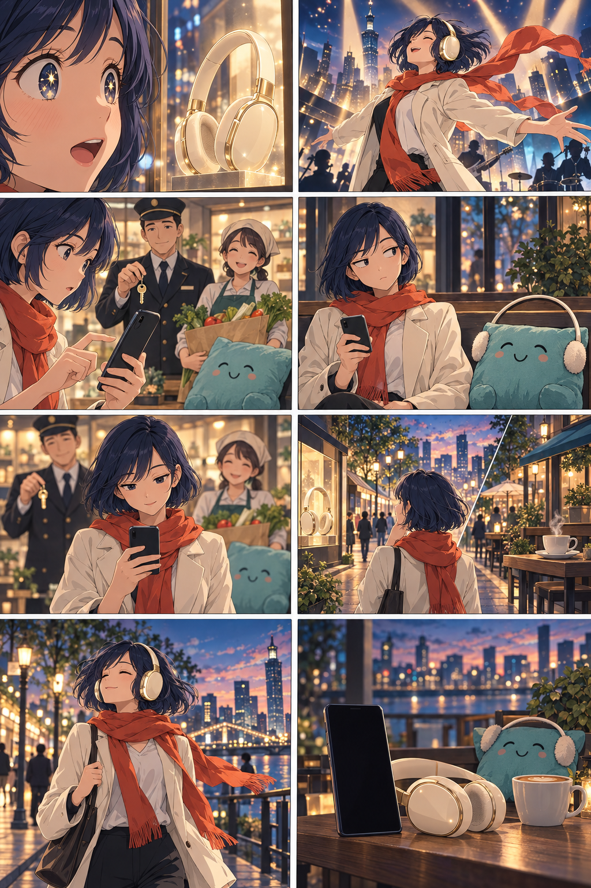

# Можно? Развлекательный плейбук для трейлера

Версия 14 сентября 2026 года. Мы готовим сценарий концепт-трейлера будущего продукта. Ситуации и герои вымышлены. Показанный интерфейс будет концептом, а цифры в демонстрации являются иллюстративным расчетом.

## Подача

Мы рассказываем короткие истории о моменте перед покупкой. У героя есть понятное желание, воображение превращает его в маленькое аниме-приключение, затем в сцену вмешивается бытовая реальность. Продукт помогает понять последствия. Финальное решение остается за героем.

Наш комедийный прием: обязательные расходы становятся вежливыми персонажами. Аренда приходит с ключами, Продукты несут пакет овощей, Подушка безопасности буквально устраивается на диване. Они напоминают о себе, не ругают человека и не запрещают ему получать удовольствие.

Главная эмоция: узнавание, улыбка, облегчение от понятного плана. Мы не обещаем увеличить доход, устранить тревожность или гарантировать финансовую безопасность.

## Банк развлекательных сцен

| Ситуация | Визуальная шутка и реплика | Как появляется Можно? |
|---|---|---|
| Наушники мечты | Героиня примеряет наушники и мгновенно оказывается в собственном аниме-опенинге. Аренда останавливает музыку: А я в этом сезоне буду? | Мы показываем, сколько останется после покупки с учетом обязательств. |
| Зарплата пришла | Герой стоит на балконе как правитель финансовой империи. За его спиной выстраивается делегация счетов. Реплика: А вы все со мной? | Мы отделяем остаток на карте от денег на необязательные траты. |
| Пятая подписка | Из телефона выходит маленький хор сервисов. Каждый поет: Я всего на месяц. Вместе получается опера. | Мы предлагаем подтвердить регулярные платежи перед расчетом. |
| Заказ ночью | В воображении курьер скачет по облакам с гигантским бургером. Герой: Это ужин или сюжетный поворот? | Мы показываем последствия конкретной суммы, не осуждая еду или время заказа. |
| Скидка с таймером | Обратный отсчет превращается в драматический запуск ракеты. Герой ставит сцену на паузу: У меня есть минутка подумать. | Мы проверяем покупку до оплаты. Не утверждаем, что приложение следит за скидками. |
| Билет на концерт | Герой уже мысленно поет на стадионе. Его календарь держит плакат: В пятницу аренда. | Мы показываем ближайшие обязательства и остаток после билета. |
| Встреча с друзьями | Воображаемый совет директоров выбирает между рестораном и пикником. Один участник совета является собакой с серьезным лицом. | Герой сам вводит два варианта расходов, мы сравниваем их последствия. |
| Кроссовки новой жизни | После примерки герой видит монтаж: марафон, горы, новая личность. Возвращение в магазин: Пока только до метро. | Мы считаем покупку, не споря с мечтой. |
| Доход фрилансера | Сообщение Оплачу завтра превращается в воздушный замок. Героиня осторожно проверяет его пальцем. | Мы честно показываем, что ожидаемые деньги еще не поступили. Нет уверенного Можно при недостаточных данных. |
| Отпуск и мелкая покупка | Чемодан ревниво смотрит на очередную коробку: Мы вообще летим? | Мы показываем защищенную сумму цели и влияние сценария только при наличии подтвержденных данных. |

Мы не выдаем эти ситуации за результаты интервью. Это варианты для творческого теста.

## Основной трейлер: Наушники и незваные гости

Длительность: 45 секунд. Основной формат: 16:9. Для версии 9:16 мы отдельно компоновываем ключевые кадры. Центральную композицию сохраняем там, где это возможно, но не обрезаем автоматически важные действия.

Героиня: взрослая девушка около 27 лет, короткое темно-синее каре, светлая куртка, красно-оранжевый шарф. Она самостоятельная и остроумная. Мы сохраняем связь с визуальным миром первой презентации.

### Сценарий по кадрам

| Кадр | Время | Действие и камера | Реплика / экранный текст | Звук и монтаж |
|---|---|---|---|---|
| 01 | 00:00-00:04 | Крупно глаза героини. В отражении витрины кремовые наушники. Медленный наезд. | Героиня: Мне кажется, это любовь. | Шум улицы стихает, одна волшебная нота. |
| 02 | 00:04-00:09 | Воображаемая сцена: наушники уже на ней, ветер подхватывает шарф, драматический свет как в опенинге. Один плавный облет. | Без титров. | На пять секунд включается оригинальный энергичный музыкальный мотив. |
| 03 | 00:09-00:14 | Резкий возврат в магазин. Аренда входит сбоку с ключами. За ней Продукты и мягкая Подушка. Камера неподвижна. | Аренда: А я в этом сезоне буду? | Музыка обрывается на сухом щелчке. Звякнули ключи. |
| 04 | 00:14-00:20 | Героиня смотрит на компанию. Подушка спокойно усаживается рядом. Короткая пауза на реакцию. | Героиня: Так. А сколько у меня свободных? | Тихий звук мягкого приземления. Пауза дает шутке сработать. |
| 05 | 00:20-00:27 | Через плечо: героиня открывает Можно? и отправляет вопрос. Отдельной вставкой показываем подтвержденные исходные данные. | Вопрос: Наушники за 12 000 ₽. Как изменится план? Затем: Данные подтверждены. | Музыка возвращается тише. Легкие звуки касаний. |
| 06 | 00:27-00:34 | Читаемая вставка интерфейса. Сначала остаток после покупки, затем дневной ориентир. Не больше двух основных чисел одновременно. | После покупки: 15 000 ₽ на необязательные траты до конца 25 сентября. Следующий экран: 1 071 ₽ в день. | Спокойный голос продукта: После покупки останется пятнадцать тысяч на необязательные траты до конца двадцать пятого сентября. |
| 07 | 00:34-00:40 | Героиня принимает решение. Склейка: выходит из магазина в наушниках. Аренда и Продукты продолжают свой путь. | Героиня: Теперь понятно. Беру. | Мотив опенинга возвращается в легкой городской аранжировке. |
| 08 | 00:40-00:45 | Телефон и наушники на столике. В глубине кадра Подушка примеряет крошечные наушники. Титр на спокойном фоне. | Можно? Затем: Пойми, что останется после покупки. Небольшая подпись: Концепт. Продукт в разработке. | Героиня за кадром: Тебе тоже? Подушка едва кивает. Короткий музыкальный финал. |

В конце мы не добавляем кнопку Скачать, QR-код или адрес до появления действующей точки входа. Для внутреннего концепта достаточно названия и отметки о стадии. Когда появится реальный набор в пилот, финальный титр можно заменить проверенной ссылкой.

## Демонстрационный расчет для монтажера

Мы используем согласованный пример из исследовательского плейбука. Снимок на начало 12 сентября, горизонт до конца 25 сентября включительно: 14 дней.

- Остаток: 120 000 ₽.
- Аренда, кредит и подписка: 45 000 ₽ суммарно.
- Защищенный резерв: 30 000 ₽. Защищенная цель в этом примере уже входит в резерв, отдельного вычета нет.
- Базовые расходы на период: 18 000 ₽.
- Допустимый бюджет: 120 000 - 45 000 - 30 000 - 18 000 = 27 000 ₽.
- Наушники: 12 000 ₽. После покупки: 15 000 ₽.
- Дневной ориентир после покупки: округление вниз 15 000 / 14 = 1 071 ₽. Еще 6 ₽ остаются нераспределенными.

В кадре с результатом остается подпись: При подтвержденных данных. Базовые расходы и резерв учтены. Для концепт-демонстрации добавляем небольшую метку Пример расчета. Сумму будущего дохода не прибавляем до поступления. Экран является макетом планируемого сценария, а не записью работающего приложения.

## Две альтернативные концовки

Мы можем тестировать концовки, сохраняя одинаковое начало и расчет.

**Покупка сейчас.** Основной вариант выше. Он показывает, что продукт помогает получать удовольствие осознанно.

**Решение подождать.** После результата героиня говорит: Хочу оставить больше свободы. Вернусь позже. Она сохраняет свой план и уходит на встречу с друзьями. Мы не утверждаем, что ожидание обязательно улучшит финансы, и не называем точную дату без отдельного расчета.

## Короткая версия на 15 секунд

00:00-00:03: наушники и мгновенный опенинг. Реплика: Мне кажется, это любовь.

00:03-00:06: входит Аренда с ключами. Реплика: А я в этом сезоне буду?

00:06-00:11: вопрос о наушниках за 12 000 ₽, затем читаемый результат 15 000 ₽ после покупки. Подписи: На необязательные траты до 25 сентября. Пример расчета.

00:11-00:15: героиня в наушниках, название Можно?, финальная фраза Пойми, что останется после покупки. Концепт. Продукт в разработке.

В короткой версии мы убираем дневной ориентир, чтобы зритель успел прочитать основной результат. Это отдельный монтаж, а не ускоренная 45-секундная версия.

## Правила визуального мира

Мы используем оригинальный аниме-стиль с выразительными взрослыми героями, детальными городскими фонами и теплой комедией. Палитра: глубокий индиго, бирюза, абрикосовый свет и молочный белый. Реальный мир спокойнее фантазии. Воображаемый опенинг допускает ветер, световые акценты и преувеличенные позы.

Аренда выглядит как вежливый взрослый с ключами, Продукты как человек с пакетом покупок, Подушка как мягкий предмет с простой мимикой. Мы не превращаем долги, маленький доход или необходимые расходы в повод для насмешки. Смешно столкновение фантазии с бытом.

Мы избегаем дождя из монет, обещания богатства, борьбы с плохим пользователем, страшных кредиторов и интерфейса, который распоряжается деньгами. Не показываем автоматическое подключение к банку или платеж от имени продукта.

## Пакет для будущей видеогенерации

Мы генерируем восемь коротких сцен отдельно. Перед анимацией нужны индивидуальные ключевые кадры: контактная раскадровка служит ориентиром, но не заменяет их. Для постоянства персонажей используем один утвержденный референс героини и отдельный лист трех бытовых персонажей.

Для каждого фрагмента передаем: исходный кадр, действие, движение камеры, длительность, финальное состояние, постоянные детали внешности и ограничения. Один фрагмент содержит одно основное действие. Между фрагментами оставляем монтажные склейки вместо сложных превращений лица и одежды.

Ниже промпты не привязаны к конкретной модели и не гарантируют поддержку точного хронометража. Длительность окончательно выставляем на монтаже. Озвучку, русский текст и точные финансовые цифры добавляем отдельными слоями после генерации. В видеоисходниках экраны оставляем чистыми.

### Постоянный блок для всех сцен

Original cinematic adult anime comedy, hand-painted cel shading, contemporary city at blue hour, deep indigo and teal with warm apricot lighting. Same adult woman, approximately 27, short dark-blue bob haircut, cream jacket, orange-red scarf. Preserve face, age, hair, outfit and headphone design across shots. Natural anatomy, expressive subtle comedy, no copyrighted characters. No generated text, subtitles, logos, numbers or app interface. No money appearing, no bank transfer, no extra fingers. Keep the main action readable with room for later typography.

### Покадровые промпты

**01, 4 секунды.** Extreme close-up of the woman's eyes as she notices cream over-ear headphones in a store window. Gentle slow push-in, eyes widen slightly with delighted recognition. End with a still look toward the headphones. No camera orbit.

**02, 5 секунд.** Same woman in an imagined playful anime opening, wearing the same cream headphones. Scarf moves in a gentle theatrical wind, a warm spotlight reveals her heroic but funny pose. One short smooth camera arc. Keep her feet grounded and face unchanged. End on the confident pose.

**03, 5 секунд.** Hard cut to the real shop. Woman foreground. One polite adult holding house keys steps into the side of frame. Behind them wait an adult carrying groceries and a small soft teal cushion character. Locked camera, simple entrance, no threatening expressions. End with all characters waiting.

**04, 6 секунд.** Medium reaction shot of the woman raising one eyebrow. The small teal cushion settles softly onto a bench beside her. Hold a comic pause. Minimal camera movement, no talking mouth animation required. End with her looking down toward her phone.

**05, 7 секунд.** Over-the-shoulder closeup of the woman holding a smartphone and making one deliberate tap. Screen is clean dark neutral surface for later compositing, no generated interface. Keys and grocery bag softly out of focus in background. Hold the phone steady at the end. Exact interface is a separate edit insert.

**06, 7 секунд.** Stable macro shot of the smartphone in the woman's hand, clean blank screen facing camera with limited reflections. Very slow push-in, no rotation, no finger crossing the display. Screen content will be composited in postproduction. End with a stable readable frame. Do not animate financial numbers.

**07, 6 секунд.** Same woman walks out of the store wearing cream headphones and smiles with quiet confidence. Medium tracking shot, natural walking, same scarf and jacket. A polite person with keys and a grocer continue down the sidewalk independently. No celebratory money, no product controlling the purchase.

**08, 5 секунд.** Cinematic product end frame: smartphone and cream headphones on a cafe table, empty dark area for the title. In the softly focused background the teal cushion tries on tiny earmuffs and makes one subtle nod. Camera locked, no text generated, no new characters. End with a held composition for the logo and tagline.

## Монтаж и звук

Мы пишем оригинальный короткий музыкальный мотив: яркий воображаемый опенинг, резкая пауза при появлении Аренды, затем спокойная легкая версия того же мотива. Не используем узнаваемую музыку конкретного аниме без прав.

Голос героини живой и ироничный. Голос продукта спокойный, без наставлений и обещаний. Реплики персонажей записываем отдельно: это позволяет сохранять понятность даже при несовершенном липсинке. Интерфейсные вставки оставляем читаемыми, не ускоряем их ради темпа.

Проверяем три вещи на черновом монтаже: зритель понимает задачу продукта после одного просмотра, успевает прочитать основную сумму, не воспринимает результат как приказ купить. Хронометраж реплик проверяем реальным чтением, при необходимости сокращаем слова вместо ускорения голоса.

## Что должно получиться перед генерацией видео

Сценарий на 45 секунд, короткий монтаж на 15 секунд, контактная раскадровка из 8 кадров, затем 8 индивидуальных ключевых кадров, референсы героев, отдельный макет интерфейса с проверенной арифметикой, дорожки реплик и музыки, финальный титр с корректным статусом продукта. Этот документ и контактная раскадровка составляют текущий сценарный пакет; индивидуальные кадры, интерфейс и видео являются следующим этапом.

## Визуальная раскадровка

Мы читаем кадры слева направо, сверху вниз. Это визуальный ориентир по эмоциям и персонажам. В шестом кадре показана метафора выбора: в финальном монтаже здесь размещаем читаемую вставку интерфейса из сценария. Наушники на Подушке оставляем для финального гэга, в более ранних индивидуальных кадрах убираем их.
